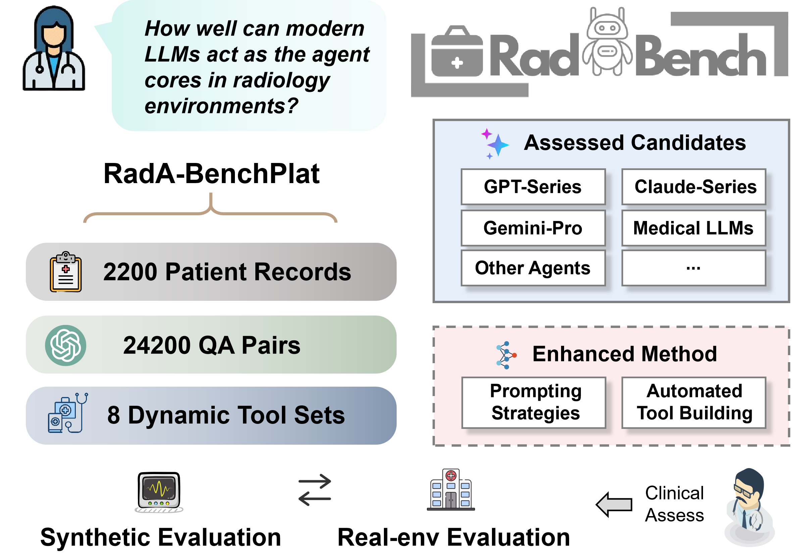
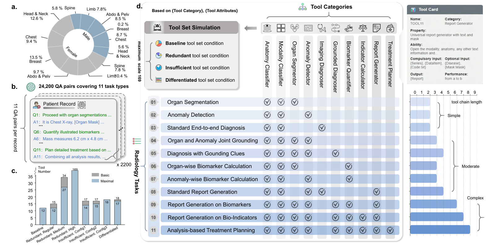
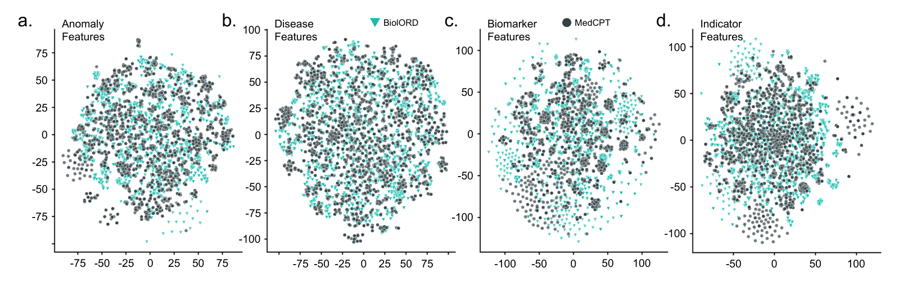
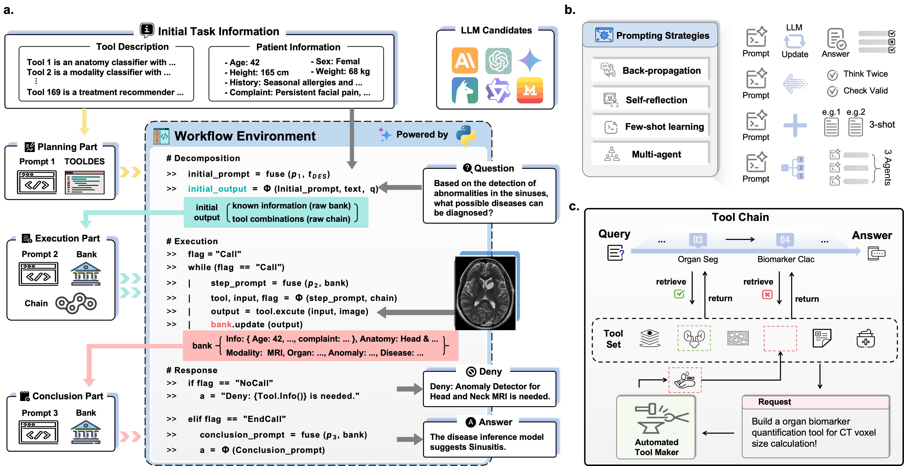
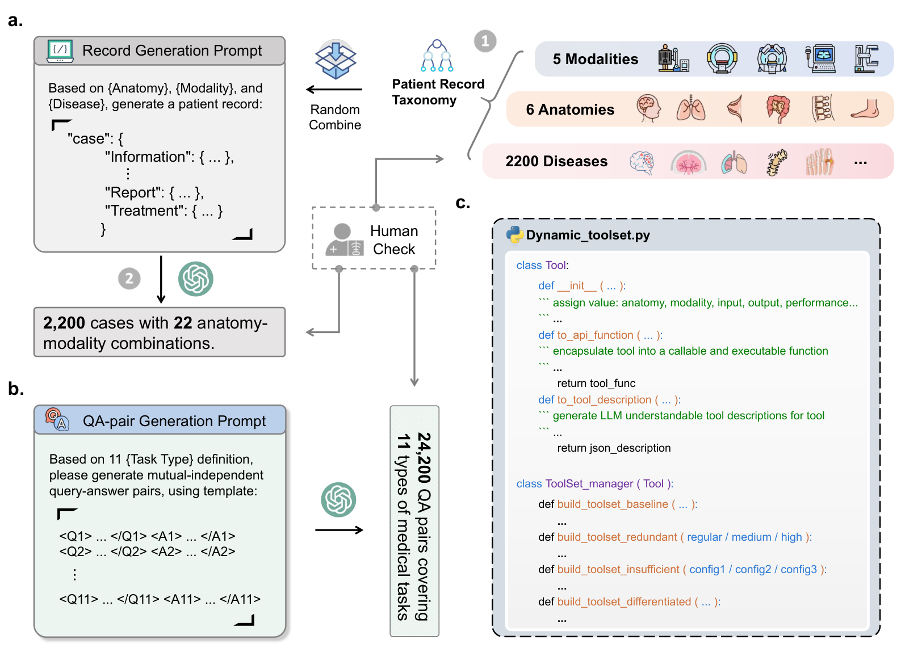
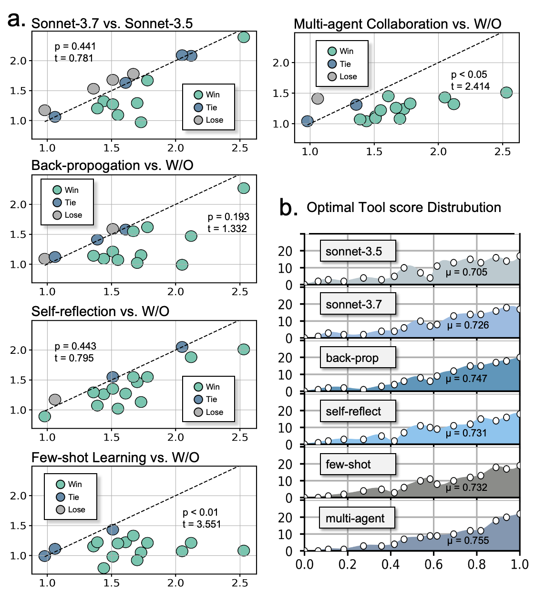

<div align="center">


**How Well Can Modern LLMs Act as Agent Cores in Radiology Environments?**

A two-layer benchmark for radiology agents: an idealized layer that isolates
reasoning from tool failure, and a real-environment layer that measures what
agentic systems actually achieve on executable radiology tasks.

[](https://arxiv.org/pdf/2412.09529)
[](https://huggingface.co/datasets/QiaoyuZheng/RadABench-Data)
[](https://github.com/MAGIC-AI4Med/M3Builder)
[](./LICENSE)



</div>

---

## What we found

- **The bottleneck is execution fidelity, not planning.** Agents form plausible
  plans and pick competitive tools, then lose the thread mid-chain. Chain
  distances stay small as difficulty grows while ECR and PFSP collapse.
- **Tool-level competence does not become task success.** Agents hit
  intermediate milestones and still fail to decide which result answers the
  question, or to put it in the required form.
- **Awareness outruns grounding.** Under insufficient tools, agents detect that
  a task is impossible far more reliably than they identify *what* is missing.
- **Redundancy breaks dependencies, not selection.** With many similar tools
  the failure is I/O coupling and error propagation, not picking the wrong one.
- **Prompting and AutoTB help, but do not close the gap.** They lift execution
  success to 94.5% in the easier settings; persistent usage errors suggest
  agents often know *when* to act without knowing *how* to use the tool.

Radiology agents are no longer only conceptual demonstrations, but the distance
from idealized orchestration to deployment is still real, and it depends as
much on tool reliability and interface alignment as on the LLM core.

---

## Contents

- [Why two layers](#why-two-layers)
- [Quick start](#quick-start)
- [The synthetic layer](#the-synthetic-layer)
  - [Patient records](#patient-records), [Task types](#task-types), [Tool categories](#tool-categories), [Tool-set conditions](#tool-set-conditions)
- [The agent workflow](#the-agent-workflow)
- [Prompting strategies](#prompting-strategies)
- [AutoTB](#autotb-automated-tool-building)
- [The real-environment layer](#the-real-environment-layer)
- [Citation](#citation)

---

## Why two layers

Radiology is a natural testbed for agentic AI, with its heterogeneous
modalities, layered anatomy and evolving protocols, and a high-stakes one. But
when an agent
fails on a real radiology task, two very different things can have gone wrong:
the agent reasoned badly, or the tool it called was simply not good enough.
A single-layer benchmark cannot tell these apart.

So RadA-BenchPlat separates them.

| | **Synthetic layer** | **Real-environment layer** |
|---|---|---|
| Tools | perfectly simulated | actually executable |
| Scale | 2,200 records, 24,200 QA pairs | 165 cases |
| Coverage | 22 anatomy-modality combinations, 11 tasks, 8 tool-set conditions | grounding, diagnosis, report generation |
| Answers | *Can the agent core reason, plan, and orchestrate?* | *Does any of that survive contact with real tools?* |
| Failure attributable to | the agent core alone | the core, the tools, or the interface between them |

The headline finding is that the answers differ. High completion rates under
idealized tools do **not** carry over: the best agents trail their reported
tool-performance ceiling by ~15% and fall to **0.327** on long-chain tasks.

<div align="center"></div>

<div align="center"><sub><b>a.</b> Patient sex across anatomical regions. <b>b.</b> 10 tool categories by 11 task types, checkmarks marking the tools each task needs. <b>c.</b> 24,200 QA pairs by task type. <b>d.</b> Tool counts across the eight simulated conditions.</sub></div>

---

## Quick start

### 1. Install

```bash
git clone https://github.com/MAGIC-AI4Med/RadABench.git
cd RadABench
pip install -r requirements.txt
```

### 2. Configure credentials

No key is ever stored in source. Copy the template and fill in only the
providers you intend to run:

```bash
cp .env.example .env
$EDITOR .env
```

```ini
ANTHROPIC_API_KEY=sk-ant-...
OPENAI_API_KEY=sk-...
# ANTHROPIC_BASE_URL=          # only when routing through a gateway
```

Environment variables take precedence over `.env`, so CI can inject secrets
without touching the file.

### 3. Run a smoke test

Five cases on the Baseline tool set, enough to confirm the loop works before
committing to a full run:

```bash
cd EvalPlat
python EvalPipeline_multihop_general.py \
    --model claude-sonnet-4.5 \
    --limit 5
```

Every pipeline takes the same arguments:

| Flag | Meaning |
|---|---|
| `--model` | alias from `Configs/models.yaml` (`--help` lists all 14) |
| `--model-path` | local checkpoint, for `local_hf` backends only |
| `--data` | records + QA file; defaults to the 110-case subset shipped here |
| `--out` | output root; traces land in `<out>/<model>/<run tag>/` |
| `--start` | first case index, for resuming an interrupted run |
| `--limit` | cap the number of cases |

### 4. Score it

```bash
python EvalMetrics/multihop_performance.py \
    --logs Outputs/claude-sonnet-4.5/multiGeneral/logouts
```

### 5. Run the tests

No credentials or GPU needed.

```bash
python tests/test_metrics.py          # 35 checks, every metric formula
python tests/test_realenv.py          # 32 checks, the real-environment loop
python tests/test_autotb_realloop.py  # 25 checks, AutoTB build/replan closure
python tests/test_prompting.py        # 29 checks, strategy composition
```

---

## The synthetic layer

### Patient records

A record is radiology-centric: demographics, medical history, annotated
imaging data (anatomy and pathology), and clinical findings. Records span
**22 anatomy-modality combinations** across 6 regions and 5 modalities:

| Region | Modalities |
|---|---|
| Head & Neck | X-ray, CT, MRI, US |
| Chest | X-ray, CT, MRI, US |
| Limb | X-ray, CT, MRI, US |
| Abdomen & Pelvis | X-ray, CT, MRI, US |
| Spine | X-ray, CT, MRI |
| Breast | Mammography, MRI, US |

GPT-4 generated 100 disease-centered records per combination (2,200 total)
from structured templates. A radiologist with 10+ years of experience then
polished them for over a month: **97.32%** met information-validity standards
and **96.73%** were judged clinically consistent. Three further clinicians
independently reviewed 550 sampled cases across eight criteria, with average
positive percent agreement between **0.880 and 0.935**.

<div align="center"></div>

<div align="center"><sub>Sex-balanced except for breast cases; age, height, and weight follow clinically plausible ranges.</sub></div>

### Task types

Eleven tasks, each with a required tool-category chain. Difficulty is set by
chain length: Simple (<4 steps), Moderate (4-6), Complex (>=6).

| # | Task | Tool chain | Level |
|---|---|---|---|
| 1 | Organ mask annotation | AC → MC → OS | Simple |
| 2 | Anomaly region annotation | AC → MC → AD | Simple |
| 3 | Disease diagnosis without visual clues | AC → MC → ID | Simple |
| 4 | Organ-and-anomaly image interpretation | AC → MC → [OS, AD] | Moderate |
| 5 | Disease diagnosis with visual clues | AC → MC → [OS, AD] → GD | Moderate |
| 6 | Organ-wise biomarker calculation | AC → MC → OS → BQ | Moderate |
| 7 | Anomaly-wise biomarker calculation | AC → MC → AD → BQ | Moderate |
| 8 | Common report generation | AC → MC → AD → ID → RG | Moderate |
| 9 | Report generation, biomarker-focused | AC → MC → [OS, AD] → [BQ, BQ] → RG | Complex |
| 10 | Report generation, biomarker + indicator | AC → MC → [OS, AD] → ID → [BQ, BQ] → IC → RG | Complex |
| 11 | Treatment planning | AC → MC → [OS, AD] → ID → [BQ, BQ] → IC → RG → TP | Complex |

Applying these templates to 2,200 records yields **24,200 QA pairs**
(2,200 × 11), balanced across task types and manually verified. In the data
files each task is keyed by its chain signature: `"012"` is task 1,
`"012356789"` is task 11.

### Tool categories

Ten categories cover the chains above.

> **Note on naming.** The paper and the code use different names for four
> categories. The code names are what appear in `Utils/tooluse.py`, the
> `ToolSets/*.txt` cards, and every trace log. Read this table when moving
> between the two.

| Abbr. | Paper name | Name in code | Function |
|---|---|---|---|
| AC | Anatomy Classifier | `Anatomy Classifier` | Predicts the anatomical region |
| MC | Modality Classifier | `Modality Classifier` | Predicts the imaging modality |
| OS | Organ Segmentor | `Organ Segmentor` | Dense masks for a given organ |
| AD | Anomaly Detector | `Anomaly Detector` | Masks or boxes for a given anomaly type |
| ID | Imaging Diagnoser | **`Disease Diagnoser`** | Diagnosis from the image alone |
| GD | Grounded Diagnoser | **`Disease Inferencer`** | Diagnosis from image + text + grounding clues |
| BQ | Biomarker Quantifier | `Biomarker Quantifier` | Biomarkers from image and dense masks |
| IC | Indicator Calculator | **`Indicator Evaluator`** | Clinical indicators, e.g. tumour grade |
| RG | Report Generator | `Report Generator` | Free-text radiology reports |
| TP | Treatment Planner | **`Treatment Recommender`** | Treatment plans from clinical findings |

Each tool is a **tool card** specifying category, properties, capabilities,
required and optional inputs, and a performance figure sampled from a
clinically plausible range. Reference implementations of all ten live in
[`EvalPlat/Toolkit/`](EvalPlat/Toolkit).

### Tool-set conditions

Real clinical environments do not hand an agent exactly the tools it needs.
Nine tool pools simulate what they do hand it. Full mapping in
[`EvalPlat/ToolSets/README.md`](EvalPlat/ToolSets/README.md).

| Condition | File | Tools | What it tests |
|---|---|---:|---|
| **Baseline** | `toy_tools.txt` | 12 | Can the agent orchestrate at all? |
| **Redundant**, regular | `basic_tools.txt` | 15 | Filtering under light noise |
| **Redundant**, medium | `scale_tools.txt` | 34 | Dependency tracking among similar candidates |
| **Redundant**, high | `whole_tools.txt` | 169 | Selection under heavy distraction |
| **Insufficient**, config1 | `deny1_tools.txt` | 17 | Spotting a missing *category* |
| **Insufficient**, config2 | `deny2_tools.txt` | 17 | Spotting a modality/anatomy mismatch |
| **Insufficient**, config3 | `deny3_tools.txt` | 18 | Spotting a missing *capability*, the hardest |
| **Differentiated** | `performance_tools.txt` | 18 | Picking the *most accurate* tool |

Note: the filenames predate the paper. `toy_tools.txt` is the Baseline condition,
while `basic_tools.txt` is already redundant. Trust the table, not the name.

---

## The agent workflow

<div align="center"></div>

The system has three components: an LLM agent core Φ, a tool set 𝒯, and a
memory bank ℬ. Given a clinical query, the agent runs three phases:

**Initialization.** Parse the query, decompose it into sub-tasks against the
available tools, and seed ℬ with the relevant patient data.

**Circulation.** For each sub-task, select a tool, validate its inputs,
invoke it, write the result back to ℬ, and let that result shape the next
call. This is where long chains break: state tracking and intermediate
validation are what the paper finds agents lose first.

**Conclusion.** Synthesize the accumulated evidence into a response that
actually answers the clinical query, in the format the task requires.

The platform's own structure, showing how tool cards, memory and the verifier
fit together:

<div align="center"></div>

---

## Prompting strategies

Four strategies target the coordination bottlenecks rather than the base model.

| Strategy | What it changes |
|---|---|
| **Prompt Back-propagation** | Three rounds of automated feedback plus manual adjustment over 220 QA pairs under Redundant and Insufficient conditions; the refined prompt is then fixed across the benchmark |
| **Self-reflection** | The agent verifies input correctness before invoking a tool, backed by an automated verifier |
| **Few-shot Learning** | Exemplar workflows and tool templates standardize planning and tool use |
| **Multi-agent Collaboration** | Splits the core into planner, executor, and summarizer |

```bash
python EvalPipeline_multihop_general.py --strategies fewshot,multiagent
python EvalPipeline_multihop_general.py --strategies all      # integrated
```

Outputs land under `Outputs/<model>/<run tag>+<strategies>/`, so an ablation
never overwrites its baseline. Details:
[`EvalPlat/Prompting/README.md`](EvalPlat/Prompting/README.md).

<div align="center"></div>

Combined, they lift task completion by 0.095 and 0.058 on simple and moderate
tasks, and by up to **48.2%** on complex ones. Few-shot learning and
multi-agent collaboration are the reliable wins (*p* < 0.05); self-reflection
and back-propagation alone are less stable. Multi-agent collaboration helps
most on long chains, raising unsolvability awareness and grounding by ~5%.

---

## AutoTB: automated tool building

When no suitable tool exists, a good agent should say exactly what is missing
and ask for it, not hallucinate a call. AutoTB measures whether it does, and
in the real layer actually builds what was asked for using
[M³Builder](https://github.com/MAGIC-AI4Med/M3Builder).

**Synthetic layer.** No model is trained. A case succeeds only when the agent
triggers AutoTB *and* grounds the field its condition removed: the category
for config1, anatomy and modality for config2, category plus
`InsufficientCapability` for config3. Verified success rates: **65.4%**
routine, **44.4%** advanced, **26.2%** complex. Missing-capability grounding
is the bottleneck.

**Real layer.** M³Builder trains a candidate, the candidate is validated
against the requested tool card, and only then is it registered in the
executable pool and used. Across 660 real insufficient-tool scenarios,
execution success reaches **94.5%** on regular tasks and falls to **65.4%** on
complex ones.

```bash
# synthetic layer: score build requests
python EvalPlat/AutoTB/run_synthetic.py \
    --logs Outputs/claude-sonnet-4.5/multiDenyl2/logouts \
    --condition config2
```

```python
# real layer: 660 scenarios, built and used end to end
from RealEnv.autotb_scenarios import build_scenarios, run_all_scenarios

scenarios = build_scenarios(manifest, pool)        # 220 per tier
report = run_all_scenarios(scenarios, agent_factory, runner, registry)
```

Outcomes are attributed to one of five modes (planning, grounding,
construction, usage, success), so a build that fails is never confused with a
tool that was built and then called wrongly. Protocol and failure boundaries:
[`EvalPlat/AutoTB/README.md`](EvalPlat/AutoTB/README.md).

---

## The real-environment layer

165 cases with executable tools and no synthetic conversion: the original
clinical question, image, and reference annotation or report.

| Task | Cases | Source | Metrics |
|---|---:|---|---|
| Organ & anomaly joint grounding | 55 | Chest Imagenome | Dice, Jaccard |
| Diagnosis with grounding clues | 55 | RadGenome-BrainMRI | Accuracy, Jaccard |
| Standard report generation | 55 | RadGenome-BrainMRI | RadGraph-F1, RaTE |

All three also carry LLM ratings (GPT-5.2-Chat, Gemini-3.0-Pro, DeepSeek-R1)
and blinded ratings from two expert radiologists.

### Results

Grounding is scored on 55 Chest Imagenome cases; diagnosis and report
generation on 55 RadGenome-MRI cases each. All metrics are higher-is-better.
LLM Rating averages three evaluators (GPT-5.2-Chat, Gemini-3.0-Pro,
DeepSeek-R1); Human Rating averages two expert radiologists under blinded
review.

Columns 2-5 are organ / anomaly joint grounding, 6-9 diagnosis with grounding
clues, 10-13 standard report generation.

| Method | Dice | Jacc. | LLM | Human | Acc. | Jacc. | LLM | Human | RadGraph-F1 | RaTE | LLM | Human |
|---|---|---|---|---|---|---|---|---|---|---|---|---|
| **General closed-source** | | | | | | | | | | | | |
| GPT-4o | 0.467 | 0.305 | 2.455 | 2.127 | 0.418 | 0.305 | 2.727 | 2.818 | 0.103 | 0.328 | 2.927 | 2.382 |
| o3 | 0.479 | 0.315 | 2.636 | 2.455 | 0.436 | 0.335 | 2.764 | 2.873 | 0.115 | 0.345 | 2.964 | 2.455 |
| Gemini-3.0-Pro | 0.489 | 0.324 | 2.909 | 2.727 | 0.455 | 0.348 | 2.818 | 2.909 | 0.125 | 0.360 | 3.000 | 2.509 |
| Claude-Sonnet-4.5 | 0.503 | 0.336 | **3.218** | **3.164** | **0.476** | **0.364** | 2.855 | 2.945 | 0.137 | **0.385** | 3.036 | 2.564 |
| **General open-source** | | | | | | | | | | | | |
| DeepSeek-R1 | 0.486 | 0.321 | 2.582 | 2.455 | 0.394 | 0.313 | 2.618 | 2.363 | 0.100 | 0.314 | 2.727 | **2.709** |
| Llama-3.1-405B | 0.252 | 0.144 | 1.764 | 1.800 | 0.307 | 0.129 | 1.945 | 1.836 | 0.043 | 0.237 | 2.109 | 1.873 |
| Qwen3-235B | 0.462 | 0.300 | 2.455 | 2.182 | 0.364 | 0.285 | 2.545 | 2.273 | 0.091 | 0.300 | 2.636 | 2.545 |
| **Medical LLM** | | | | | | | | | | | | |
| Meditron3-70B | 0.392 | 0.244 | 2.164 | 1.927 | 0.277 | 0.204 | 1.964 | 1.818 | 0.069 | 0.248 | 2.164 | 2.036 |
| MedGemma-27B | 0.403 | 0.252 | 2.218 | 2.000 | 0.291 | 0.212 | 2.036 | 1.909 | 0.075 | 0.255 | 2.218 | 2.091 |
| Baichuan-M3-235B | 0.413 | 0.260 | 2.273 | 2.073 | 0.309 | 0.225 | 2.109 | 1.964 | 0.082 | 0.265 | 2.291 | 2.182 |
| **End-to-end medical VLM** | | | | | | | | | | | | |
| Llava-Med | 0.110 | 0.058 | 1.636 | 1.800 | 0.295 | 0.089 | 2.036 | 1.818 | 0.007 | 0.138 | 1.533 | 1.845 |
| RadFM | 0.122 | 0.065 | 1.709 | 1.855 | 0.309 | 0.105 | 2.091 | 1.909 | 0.015 | 0.150 | 1.600 | 1.909 |
| MedDr | 0.140 | 0.075 | 1.782 | 1.909 | 0.327 | 0.125 | 2.145 | 2.000 | 0.025 | 0.165 | 1.727 | 2.000 |
| **Medical agentic systems** | | | | | | | | | | | | |
| MAM | 0.406 | 0.255 | 2.273 | 2.055 | 0.351 | 0.219 | 2.345 | 2.218 | 0.077 | 0.262 | 2.800 | 2.418 |
| RadCouncil | 0.394 | 0.245 | 2.182 | 2.000 | 0.327 | 0.205 | 2.273 | 2.145 | 0.070 | 0.250 | 2.727 | 2.327 |
| AgentClinic | **0.513** | **0.345** | 3.091 | 3.091 | 0.455 | 0.355 | **2.909** | **3.000** | **0.145** | 0.370 | **3.055** | 2.636 |

The executable pool is 14 dataset-specific tool families × 3 subset-trained
variants = **42 concrete tools**, built with M³Builder and supplemented with
[nnU-Net](https://github.com/MIC-DKFZ/nnUNet) and RP3D-DM.

```bash
# rebuild the case manifest from your copies of the source datasets
python EvalPlat/RealEnv/build_manifest.py \
    --chest-imagenome /data/chest-imagenome \
    --radgenome /data/radgenome-brainmri

# run the evaluation
python EvalPlat/RealEnv/run_real_eval.py \
    --model claude-sonnet-4.5 --executor mytools.runner:run_tool \
    --task report_generation --llm-rating
```

**The images are not in this repository.** Chest Imagenome derives from
MIMIC-CXR and RadGenome-BrainMRI from the BraTS cohorts; both need
credentialed access. What ships is the manifest schema, the selection criteria
as runnable code, the tool pool, every metric, and the rating protocol, so the
evaluation set can be rebuilt exactly once you hold the source data. See
[`EvalPlat/RealEnv/README.md`](EvalPlat/RealEnv/README.md).

**The idealized-executable gap.** For each metric we define a reported
tool-performance ceiling *Uₘ* by substituting the officially reported
performance of the underlying task-specific tool into the idealized protocol,
and compare it to the column-wise best observed score *Cₘ*:

> Δₘ = (Uₘ − Cₘ) / Cₘ × 100%,  **mean 15.5%**, largest on diagnosis
> accuracy (21.2%).

*Uₘ* assumes correct orchestration and reported tool performance. It is a
computational reference point, not a theoretical or clinically attainable
upper bound, and *Cₘ* is an envelope across systems rather than the output of
one deployable agent.

---

## Citation

```bibtex
@article{zheng2024radabench,
  title   = {How Well Can Modern LLMs Act as Agent Cores in Radiology Environments?},
  author  = {Zheng, Qiaoyu and Zhao, Ziheng and Wu, Chaoyi and Zhang, Ya and Wang, Yanfeng and Xie, Weidi},
  journal = {arXiv preprint arXiv:2412.09529},
  year    = {2024}
}
```

If you use the AutoTB layer, please also cite M³Builder:

```bibtex
@article{feng2025m3,
  title   = {M$^3$Builder: A Multi-Agent System for Automated Machine Learning in Medical Imaging},
  author  = {Feng, Jinghao and Zheng, Qiaoyu and Wu, Chaoyi and Zhao, Ziheng and Zhang, Ya and Wang, Yanfeng and Xie, Weidi},
  journal = {arXiv preprint arXiv:2502.20301},
  year    = {2025}
}
```

## License

MIT. See [LICENSE](./LICENSE).
